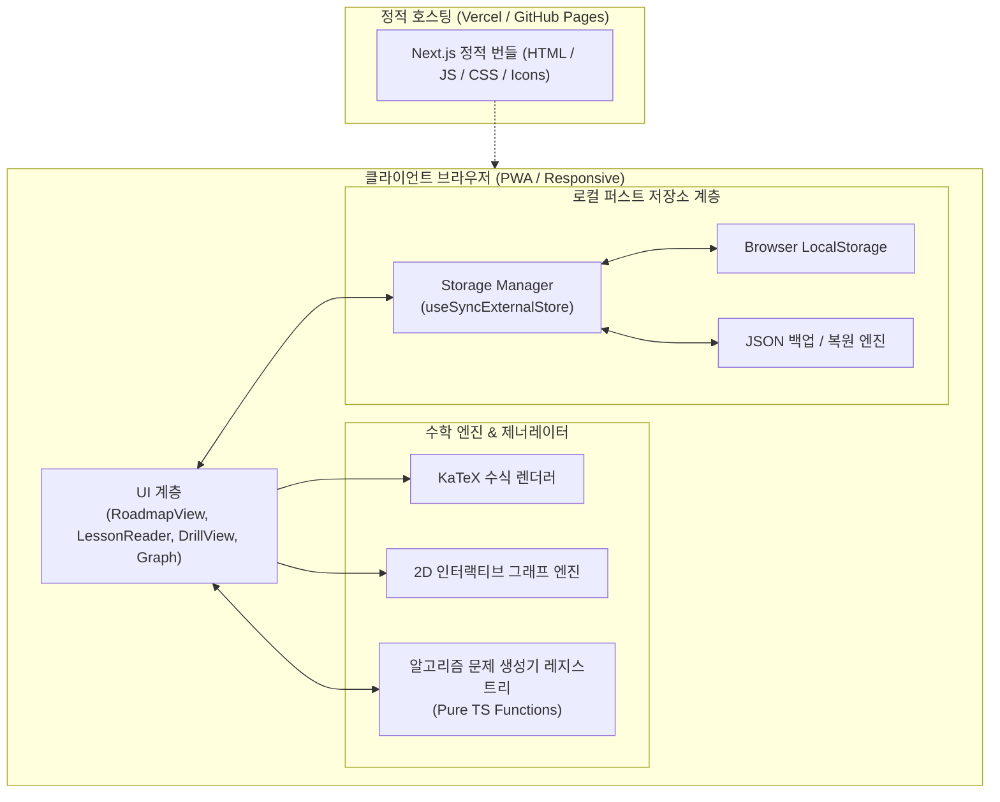

# 📐 Mathtudy 시스템 아키텍처 및 커리큘럼 명세서

> **문서 버전**: 1.0.0  
> **최종 수정일**: 2026-10-26  
> **프로젝트 성격**: 성인을 위한 산수~고급수학 독학 플랫폼 (PWA · DB-less · Local-First)

---

## 1. 아키텍처 개요 (System Overview)

Mathtudy는 별도의 데이터베이스나 백엔드 API 서버를 두지 않는 **완전한 클라이언트 중심(Local-First) 서버리스 웹 애플리케이션**입니다. 

### 시스템 구성도



---

## 2. 100% DB-less 동작 메커니즘

### 1) 무한 알고리즘 문제 생성 (Zero-DB Problem Bank)
* 데이터베이스에 수만 개의 문제를 고정 저장하지 않습니다.
* TypeScript 기반 순수 함수가 요청 시마다 난수 파라미터를 시드로 삼아 실시간으로 문제를 계산하고 합성합니다.
* **장점**:
  * DB 저장 공간 0 Byte
  * 동일 단원에서도 무한히 다양한 난수 문제 생성
  * 지연 시간(Latency) 0ms

### 2) 브라우저 로컬 영구 보존 스키마
사용자의 모든 학습 상태는 브라우저 `localStorage`의 `mathtudy_user_progress_v1` 키에 JSON으로 저장됩니다.

```typescript
export interface UserProgressRecord {
  totalSolved: number;         // 총 푼 문제 수
  totalCorrect: number;        // 정답 문제 수
  streak: number;              // 연속 학습일 (Day Streak)
  lastActiveDate: string;      // 최근 학습일 (YYYY-MM-DD)
  topicMastery: Record<string, {
    solved: number;            // 단원별 풀이 수
    correct: number;           // 단원별 정답 수
    lastPracticed: string;     // 최근 학습일
    level: number;             // 마스터리 레벨 (0 ~ 5)
  }>;
  incorrectProblemIds: string[]; // 오답 복습용 문제 ID 목록
  diagnosticScore?: {
    date: string;              // 진단 평가 응시일
    score: number;             // 점수 (0 ~ 100)
    recommendedTopicId: string;// 추천 시작 단원 ID
  };
}
```

### 3) 1클릭 백업 & 이전 메커니즘
* **내보내기(Export)**: 저장된 JSON 객체를 `mathtudy_backup_YYYY-MM-DD.json` 파일로 브라우저에서 즉시 다운로드.
* **불러오기(Import)**: 사용자가 업로드한 JSON 파일의 구조를 검증한 후 `localStorage`에 복원.
* **효과**: 스마트폰 ↔ PC 기기 변경 시 데이터 유실 없이 그대로 이전 가능.

---

## 3. 전체 커리큘럼 명세 (초등 산수 ~ 대학 고급수학)

| 대단원 | 소단원 ID | 단원명 | 핵심 학습 목표 | 교육과정 수준 |
| :--- | :--- | :--- | :--- | :--- |
| **01. 기초 산수** | `fractions` | 분수의 덧셈과 통분 | 공통분모 통분 및 기약분수 약분 | 초등 5~6학년 |
| | `operations-order` | 사칙혼합연산 우선순위 | 괄호 → 곱셈/나눗셈 → 덧셈/뺄셈 (PEMDAS) | 초등 5학년 |
| **02. 정수와 유리수** | `negative-numbers` | 음수의 연산과 부호 규칙 | 부호 곱셈 규칙 및 음수 뺄셈 | 중학교 1학년 |
| | `exponents` | 기초 지수법칙 | $a^m \times a^n = a^{m+n}$, $(a^m)^n = a^{mn}$ | 중학교 2학년 |
| **03. 일차방정식** | `linear-equations` | 일차방정식 기본 풀이 | 등식의 성질, 이항과 $ax+b=c$ 풀이 | 중학교 1학년 |
| | `linear-equations-advanced` | 양변 미지수 방정식 | $ax+b=cx+d$ 동류항 이항 정리 | 중학교 1학년 |
| | `systems-equations` | 연립일차방정식 (가감법) | 미지수 2개 소거법 풀이 | 중학교 2학년 |
| **04. 일차함수와 기하** | `linear-functions-slope` | 직선의 기울기와 절편 | 기울기 $m = \frac{\Delta y}{\Delta x}$, 2D 인터랙티브 그래프 | 중학교 2학년 |
| | `linear-functions-intercept` | 일차함수의 $x\cdot y$절편 | 좌표축 교차점 계산 | 중학교 2학년 |
| | `pythagoras` | 피타고라스 정리 | 직각삼각형 $c^2 = a^2 + b^2$ | 중학교 3학년 |
| **05. 이차방정식** | `quadratics-factoring` | 인수분해와 이차방정식 | 합과 곱으로 $(x-\alpha)(x-\beta)=0$ 해 도출 | 중학교 3학년 |
| | `quadratic-discriminant` | 판별식 ($D=b^2-4ac$) | 실근 개수와 허근 판정 | 고등학교 1학년 |
| **06. 삼각함수와 로그** | `special-angles` | 특수각의 삼각비 | $30^\circ, 45^\circ, 60^\circ$의 $\sin, \cos, \tan$ | 중3 ~ 고2 (수I) |
| | `log-basic` | 로그의 정의와 계산 | 지수의 역연산, $\log_a b = c \iff a^c = b$ | 고등학교 2학년 (수I) |
| | `arithmetic-sequence` | 등차수열의 일반항 | $a_n = a_1 + (n-1)d$ 규칙성 도출 | 고등학교 2학년 (수I) |
| **07. 미적분학 기초** | `derivatives` | 다항함수 도함수와 미분계수 | 거듭제곱 미분 공식(Power Rule), 순간변화율 | 고등학교 2학년 (수II) |
| | `integrals` | 정적분의 계산과 넓이 | 미적분학의 기본정리(FTC) $\int_a^b f(x)dx$ | 고등학교 2학년 (수II) |
| **08. 대학 고급수학** | `matrix-determinant` | 2×2 행렬식 | $\det(A) = ad - bc$, 역행렬 존재 판정 | 대학 선형대수학 |
| | `vector-dot-product` | 벡터의 내적 (Dot Product) | $\vec{u}\cdot\vec{v}$, 코사인 유사도 | 대학 선형대수학 |
| | `partial-derivatives` | 다변수 함수의 편미분 | $\frac{\partial f}{\partial x}$, 머신러닝 경사하강법 기초 | 대학 다변수 미적분학 |

---

## 4. 프론트엔드 컴포넌트 아키텍처

```
src/
├── app/
│   ├── layout.tsx             # KaTeX 스타일 및 PWA 메타데이터 설정
│   ├── page.tsx               # 메인 뷰 스위처 (Roadmap / Lesson / Drill / Stats)
│   ├── manifest.ts            # PWA 웹앱 매니페스트
│   └── globals.css            # Tailwind CSS v4 스타일시트
├── components/
│   ├── curriculum/
│   │   ├── RoadmapView.tsx    # 8대 대단원 로드맵 및 단원별 마스터리 카드
│   │   └── LessonReader.tsx   # 교재형 개념 해설, 공식 유도, 대표 예제
│   ├── drill/
│   │   ├── DrillView.tsx      # 무한 난수 드릴 풀이 뷰
│   │   ├── MultipleChoice.tsx # 터치 최적화 4지선다형 선택 컴포넌트
│   │   └── StepSolution.tsx   # 오답 시 단계별 전개 풀이(Step 1,2,3) 해설
│   ├── diagnostic/
│   │   └── DiagnosticModal.tsx# 5분 전 영역 빠른 레벨 진단 평가 모달
│   ├── stats/
│   │   └── BackupModal.tsx    # JSON 백업 다운로드 및 파일 복원 모달
│   └── ui/
│       ├── MathRenderer.tsx   # KaTeX 기반 고속 수식 렌더러
│       ├── MathKeypad.tsx     # 분수(/), 거듭제곱(^), 부호 가상 키패드
│       └── InteractiveGraph.tsx# 슬라이더 조절 HTML5 2D 함수 시각화 캔버스
└── lib/
    ├── storage.ts             # useSyncExternalStore 기반 브라우저 로컬 저장소 매니저
    ├── curriculum-data.ts     # 교재형 개념 해설 정적 데이터셋
    └── generators/            # 100% DB-less 수학 알고리즘 문제 생성기 모음
```

---

## 5. UI/UX 디자인 원칙

1. **Notion & Linear 스타일 미니멀리즘**:
   - 불필요한 화려한 일러스트나 아동용 게이미피케이션을 배제하고, 성인 학습자가 수학에 오롯이 몰입할 수 있는 차분한 다크 테마(`neutral-950`, `indigo-500`, `sky-400`) 적용.
2. **반응형 & PWA 지원**:
   - 모바일 홈 화면 설치 시 상하단 브라우저 UI 없이 네이티브 앱처럼 풀스크린 작동.
   - 키보드가 없는 모바일 기기에서도 원활하게 풀 수 있도록 **가상 수학 키패드**와 **객관식 선택지**를 즉시 전환할 수 있는 하이브리드 입력 인터랙션 제공.
